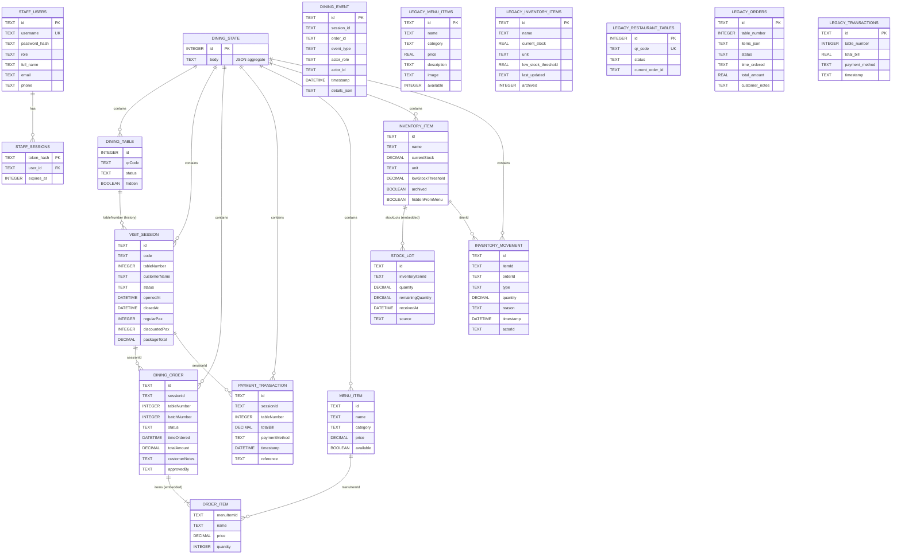

# Restaurant Management System ERD

The diagram distinguishes relational SQLite tables from the dining data stored
as JSON. `dining_state.body` is the current source for tables, visits, orders,
payments, menu, and inventory. Those JSON relationships are maintained by the
application; they are not SQLite foreign-key constraints. The separate
`menu_items`, `inventory_items`, `orders`, `restaurant_tables`, and
`transactions` tables are also present in the database as legacy flat tables.

## Relationship and storage notes

- `STAFF_SESSIONS.user_id` is the only explicit foreign key in the relational
  schema; it references `STAFF_USERS.id` with `ON DELETE CASCADE`.
- Visit/session, order, transaction, menu, inventory, and stock-lot records are
  embedded in the single `dining_state.body` JSON document. The ERD shows their
  logical relationships, not separate SQL tables.
- `DINING_EVENT.session_id` and `order_id` are audit references stored as text;
  they are not declared foreign keys.
- The legacy flat tables are shown separately because their columns are real
  SQLite tables, but the live dining workflow stores its current records in
  `dining_state`.
